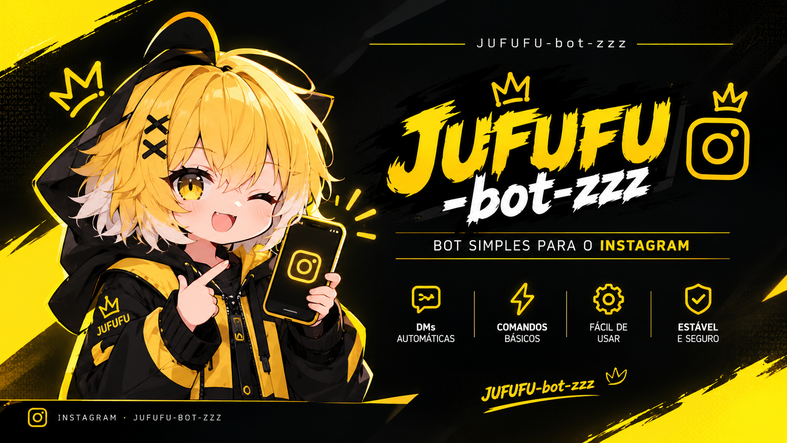

<div align="center">


<br>




<br><br>


<br>

<a href="https://github.com/elnataalves12-lang/BOT-JUFUFU-zzz">
  
</a>
<a href="https://whatsapp.com/channel/0029VbDHw0fAO7RBFTJ3rn1e">
  
</a>
<a href="https://wa.me/5591985500390">
  
</a>

<br><br>


</div>

## 🌟 〘 𝕊𝕆𝔹ℝ𝔼 𝕆 𝕁𝕌𝔽𝕌𝔽𝕌-𝕫𝕫𝕫 〙

O **JUFUFU-zzz** é um bot **gratuito e open source** para o **Instagram Direct**, feito em **Python** com a biblioteca [`instagrapi`](https://github.com/subzeroid/instagrapi).

Cada pessoa roda **sua própria cópia**, conectando **sua própria conta do Instagram**. O bot **não é um servidor público** — é um projeto para você instalar, personalizar e usar como quiser.

> 💛 **100% gratuito.** Sem mensalidade, sem chave paga, sem pegadinha.

<div align="center">

</div>

## ⚠️ 〘 𝔸𝕍𝕀𝕊𝕆 𝕀𝕄ℙ𝕆ℝ𝕋𝔸ℕ𝕋𝔼 — 𝕃𝔼𝕀𝔸 𝔸ℕ𝕋𝔼𝕊 𝔻𝔼 𝕌𝕊𝔸ℝ 〙

<div align="center">


</div>

> **Este bot usa a API privada do Instagram (`instagrapi`), que NÃO é oficial.**
>
> O Instagram **pode** detectar o uso, bloquear temporariamente ou **banir permanentemente** a conta que estiver rodando o bot.
>
> **O desenvolvedor não se responsabiliza por contas banidas, perdidas ou bloqueadas.** O bot é entregue **como está** ("as is"), sem garantias.

<div align="center">

### 🛡️ ❰ ℂ𝕆𝕄𝕆 ℝ𝔼𝔻𝕌ℤ𝕀ℝ (𝕄𝕌𝕀𝕋𝕆) 𝕆 ℝ𝕀𝕊ℂ𝕆 ❱

| ✅ | Recomendação |
|:---:|:---|
| 🥇 | **NUNCA use sua conta principal.** Use uma conta secundária, velha, que você não usa mais. |
| 🥈 | **Se criar uma conta nova, "aqueça" ela antes.** Deixe **3 a 7 dias parada**. Depois use **manualmente** por mais alguns dias: assista Reels, curta vídeos, comente, siga pessoas, mande mensagens para amigos. |
| 🥉 | **Não rode o bot 24h no primeiro dia.** Comece com poucas horas e aumente aos poucos. |
| 🎯 | **Não use o bot para spam.** Mandar a mesma mensagem para dezenas de pessoas é o caminho mais rápido para o ban. |
| 🛑 | **Se aparecer `ChallengeRequired`, pare o bot imediatamente** e resolva a verificação manualmente no app do Instagram. |

</div>

> 💡 **Regra de ouro:** conta nova + bot rodando direto = ban quase garantido. Conta velha + uso humano + bot = risco baixo.

<div align="center">

</div>

## ✨ 〘 ℂ𝕆𝕄𝔸ℕ𝔻𝕆𝕊 𝔻𝕀𝕊ℙ𝕆ℕÍ𝕍𝔼𝕀𝕊 〙

<div align="center">


</div>

> 📌 **Prefixo único:** `/` (pode ser alterado em `config.py`)

| Comando | O que faz |
|:---:|:---|
| `/menu` | Mostra o menu com imagem |
| `/play <música>` | Baixa do YouTube e envia (áudio ≤60s, vídeo >60s) |
| `/corta` *(responder mídia)* | Recorta o centro da foto/vídeo e deixa quadrado 512x512 |
| `/mudo` *(responder vídeo)* | Remove o áudio do vídeo |
| `/ping` | Status do bot |
| `/perfil` | Perfil de brincadeira |
| `/id` | Mostra seu ID e o ID da conversa |
| `/dado` | Rola um dado (1–6) |
| `/moeda` | Cara ou coroa |

<div align="center">

</div>

## 📱 〘 𝕀ℕ𝕊𝕋𝔸𝕃𝔸ÇÃ𝕆 ℕ𝕆 𝕋𝔼ℝ𝕄𝕌𝕏 〙

<div align="center">

</div>

### 🥇 Passo 1 — Instale o Termux

Baixe o **Termux** pelo **F-Droid** (recomendado):

<div align="center">

<a href="https://f-droid.org/packages/com.termux/" target="_blank">
  
</a>

</div>

> ⚠️ **Não use** a versão antiga da Play Store — ela está desatualizada.

### 🥈 Passo 2 — Atualize o Termux

```bash
pkg update && pkg upgrade -y
```

🥉 Passo 3 — Instale os requisitos

```bash
pkg install python ffmpeg git nodejs -y
```

<div align="center">

Pacote Para que serve
🟢 python Rodar o bot
🟢 ffmpeg Processar áudio e vídeo
🟢 git Clonar o projeto
🟢 nodejs Necessário para o yt-dlp funcionar bem

</div>

🎁 Passo 4 — Conceda acesso ao armazenamento (opcional)

```bash
termux-setup-storage
```

Aceite a permissão que aparecer na tela.

<div align="center">

</div>

📥 〘 𝔹𝔸𝕀𝕏𝔸ℝ 𝕆 ℙℝ𝕆𝕁𝔼𝕋𝕆 〙

📦 Passo 5 — Clone o repositório

```bash
git clone https://github.com/elnataalves12-lang/BOT-JUFUFU-zzz.git
```

📂 Passo 6 — Entre na pasta

```bash
cd BOT-JUFUFU-zzz
```

🔧 Passo 7 — Instale as dependências do Python

```bash
pip install instagrapi requests pillow colorama yt-dlp
```

<div align="center">

Pacote Para que serve
🐍 instagrapi Conectar e falar com o Instagram
🌐 requests Baixar mídia das URLs
🖼️ pillow Processar imagens (corta)
🎨 colorama Banner colorido no terminal
📥 yt-dlp Baixar música do YouTube

</div>

<div align="center">

</div>

⚙️ 〘 ℂ𝕆ℕ𝔽𝕀𝔾𝕌ℝ𝔸ÇÃ𝕆 〙

📝 Passo 8 — Abra o arquivo de configuração

```bash
nano config.py
```

✏️ Passo 9 — Edite os campos principais

<div align="center">

Campo O que é
USERNAME Usuário da conta do bot
PASSWORD Senha da conta
SESSIONID (opcional) Cookie do navegador
BOT_NOME Nome exibido no banner
PREFIXOS Prefixos aceitos (padrão: só /)
MENU_IMAGE_URL Link da imagem que aparece no /menu

</div>

Salve com Ctrl+O → Enter → Ctrl+X.

<div align="center">

</div>

▶️ 〘 𝕀ℕ𝕀ℂ𝕀𝔸ℕ𝔻𝕆 𝕆 𝔹𝕆𝕋 〙

🚀 Passo 10 — Rode o bot

```bash
python bot.py
```

📲 Passo 11 — Conecte sua conta do Instagram

Na primeira execução, o Instagram pode pedir um código de verificação por e-mail ou SMS. Digite o código de 6 dígitos e pressione Enter.

A sessão fica salva em jufufu_session.json — nas próximas vezes não precisa digitar de novo.

✅ Passo 12 — Verifique se está funcionando

Quando o bot conectar, vai aparecer no Termux o banner grande JUFUFU-zzz em amarelo.

Agora manda /menu numa DM do bot, e ele deve responder.

<div align="center">

</div>

📂 〘 𝔼𝕊𝕋ℝ𝕌𝕋𝕌ℝ𝔸 𝔻𝕆 ℙℝ𝕆𝕁𝔼𝕋𝕆 〙

```
jufufu-bot/
├── 📄 bot.py                  → arquivo principal do bot
├── ⚙️ config.py               → configurações do bot
├── 📦 requirements.txt        → dependências do projeto
├── 💾 jufufu_session.json     → sessão (criada no 1º login)
├── 📁 temp/                   → arquivos temporários
├── 📁 modules/
│   ├── 🎨 banner.py           → banner do terminal
│   ├── 🎭 tema.py             → tema visual das respostas
│   ├── 🔐 login.py            → conexão com o Instagram
│   ├── 📥 ytdlp.py            → download de música
│   ├── 🔊 audio.py            → conversão de áudio
│   ├── ✂️ edits.py            → corta e mudo
│   └── 💬 comandos.py         → todos os comandos
└── 📄 README.md               → este arquivo
```

<div align="center">

</div>

🔁 〘 𝕀ℕ𝕀ℂ𝕀𝔸ℝ ℕ𝕆𝕍𝔸𝕄𝔼ℕ𝕋𝔼 𝔻𝔼ℙ𝕆𝕀𝕊 〙

Para ligar o bot novamente:

```bash
cd ~/jufufu-bot
python bot.py
```

A sessão fica salva em jufufu_session.json, então não precisa logar de novo — desde que você não tenha feito logout no app do Instagram.

<div align="center">

</div>

🛠️ 〘 𝕋𝔼ℂℕ𝕆𝕃𝕆𝔾𝕀𝔸𝕊 𝕌𝕊𝔸𝔻𝔸𝕊 〙

<div align="center">

<a href="https://www.python.org/" target="_blank">
  
</a>
<a href="https://www.instagram.com/" target="_blank">
  
</a>
<a href="https://git-scm.com/" target="_blank">
  
</a>
<a href="https://ffmpeg.org/" target="_blank">
  
</a>
<a href="https://github.com/yt-dlp/yt-dlp" target="_blank">
  
</a>
<a href="https://github.com/elnataalves12-lang/BOT-JUFUFU-zzz" target="_blank">
  
</a>


🟢 Python 🟡 Instagram 🟠 Git 🔵 FFmpeg 🔴 yt-dlp ⚫ GitHub
Linguagem Conexão Versionamento Mídia Download Código

</div>

<div align="center">

</div>

🔒 〘 𝕊𝔼𝔾𝕌ℝ𝔸ℕÇ𝔸 〙

<div align="center">

⚠️ ❰ ℕ𝕌ℕℂ𝔸 ℙ𝕌𝔹𝕃𝕀ℚ𝕌𝔼 𝕆𝕌 ℂ𝕆𝕄ℙ𝔸ℝ𝕋𝕀𝕃ℍ𝔼 ❱

❌ ❌ ❌
Usuário e senha jufufu_session.json config.py preenchido
Cookies do navegador Pasta temp/ Credenciais pessoais

</div>

Cada pessoa deve rodar sua própria cópia e conectar sua própria conta do Instagram.

<div align="center">

</div>

🔗 〘 𝕃𝕀ℕ𝕂𝕊 𝕆𝔽𝕀ℂ𝕀𝔸𝕀𝕊 〙

<div align="center">

<br>

<a href="https://github.com/elnataalves12-lang/BOT-JUFUFU-zzz/tree/main" target="_blank">
  
</a>


<a href="https://whatsapp.com/channel/0029VbDHw0fAO7RBFTJ3rn1e" target="_blank">
  
</a>


<a href="https://wa.me/5591985500390" target="_blank">
  
</a>

</div>

<div align="center">

</div>

⭐ 〘 𝔸ℙ𝕆𝕀𝔼 𝕆 ℙℝ𝕆𝕁𝔼𝕋𝕆 〙

<div align="center">


<br>

<a href="https://github.com/elnataalves12-lang/BOT-JUFUFU-zzz/stargazers">
  
</a>


🤖 𝕁𝕌𝔽𝕌𝔽𝕌-𝕫𝕫𝕫

Feito para a comunidade. 💛

<br>


</div>
```
